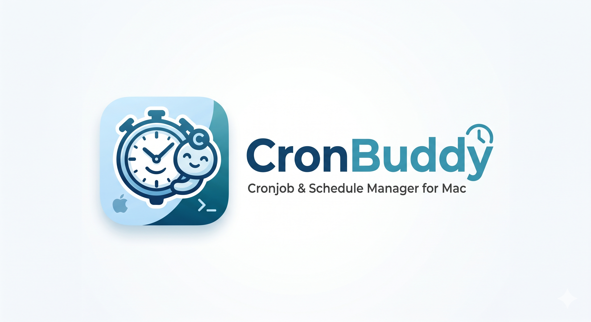

# CronBuddy

<p align="center">
  
</p>

<p align="center">
  <a href="#english">English</a> ·
  <a href="#português">Português</a> ·
  <a href="#español">Español</a>
</p>

---

<a id="english"></a>
## English

**CronBuddy** is a native macOS menu bar app for scheduling things on your Mac: shell commands, scripts, AppleScripts, Automator workflows and Shortcuts. It shows what runs next, keeps the full output of every run, and tells you when something fails.

Version 2 is a rewrite in Swift and SwiftUI. It replaces the original Python app.

### Features

- **Menu bar first.** See the next runs, each job's last result, and run or pause any job without opening a window. Optional countdown to the next run in the menu bar.
- **Four kinds of action.** A shell command, a script file (shell, Python, Ruby, AppleScript `.scpt`, JavaScript for Automation, Automator `.workflow`), inline AppleScript, or any shortcut from the Shortcuts app.
- **Schedules in plain language.** Every N minutes or hours, hourly, daily at several times, chosen weekdays, chosen days of the month, at login, or a raw cron expression. The editor previews the next runs as you type.
- **launchd or cron.** launchd is the default: it's the macOS-native scheduler and catches up on runs missed while the Mac slept. cron is there when you want it.
- **Test before saving.** *Test Run* in the editor runs the action exactly as written and streams its output live.
- **History and logs.** Every run, scheduled or manual, is recorded with its output, exit code and duration. Search inside any log, see a job's success rate, or review every run in *Activity*.
- **Notifications** when a run fails, or optionally when it succeeds, with a preview of its output.
- **Templates.** Twenty ready-made jobs: disk reports, backups, uptime checks, Homebrew updates, weather, exchange rates, break reminders, Dark Mode in the evening and more.
- **Import from crontab.** Existing crontab entries can be adopted with one click, gaining logs and history.
- **Themes.** System, Thoth (black and gold), Paper, Phosphor and Nord.

### Install

Requires macOS 14 or later and Xcode (or the Swift 6 toolchain).

```bash
git clone https://github.com/lucasrafaldini/cronbuddy.git
cd cronbuddy
make install
```

`make install` builds `CronBuddy.app` and copies it to `/Applications`. Use `make app` to only build it into `build/`, `make dmg` for a disk image, and `make test` to run the test suite.

### Permissions: one grant covers every job

macOS gives cron and launchd jobs no privacy permissions, so a job that touches iCloud Drive, Documents, external disks or other protected folders fails with `Operation not permitted`.

CronBuddy runs every job through its own executable: launchd starts `CronBuddy.app` directly, and cron starts it with `open -a`. macOS then holds CronBuddy responsible for the job, so a single grant covers all of them:

1. Open **System Settings → Privacy & Security → Full Disk Access** and add `CronBuddy.app`.
2. That's it. Every job, current and future, inherits the permission.

An ad-hoc signed build gets a new signature every time it's rebuilt, which resets the grant. To keep it across updates, sign with a stable identity:

```bash
CODESIGN_IDENTITY="Developer ID Application: Your Name (TEAMID)" make install
```

### Where things live

| What | Where |
| --- | --- |
| Job definitions | `~/Library/Application Support/CronBuddy/jobs.json` |
| Generated action scripts | `~/Library/Application Support/CronBuddy/actions/` |
| Run logs and history | `~/Library/Logs/CronBuddy/<job id>/` |
| launchd agents | `~/Library/LaunchAgents/com.lucasrafaldini.cronbuddy.job.*.plist` |
| cron entries | lines in your crontab ending in `# cronbuddy:<job id>` |

CronBuddy only touches crontab lines carrying its own marker. Your other entries are left as they are.

### Upgrading from CronBuddy 1.x

Crontab lines written by 1.x (`open -a CronBuddy.app --args --run '<command>' --name '<job>'`) keep working: version 2 understands that format and logs those runs to `~/CronBuddyScripts/logs` as before. They also appear under **Import from crontab**, labelled *CronBuddy 1.x*, so you can move them to the new history and logs when you're ready.

---

<a id="português"></a>
## Português

**CronBuddy** é um app nativo de barra de menus do macOS para agendar tarefas no Mac: comandos de shell, scripts, AppleScripts, fluxos do Automator e Atalhos. Mostra o que roda a seguir, guarda a saída completa de cada execução e avisa quando algo falha.

A versão 2 foi reescrita em Swift e SwiftUI e substitui o app original em Python.

### Recursos

- **Barra de menus em primeiro lugar:** próximas execuções, último resultado de cada job e botões para rodar ou pausar sem abrir janela. Contagem regressiva opcional até a próxima execução.
- **Quatro tipos de ação:** comando de shell, arquivo de script (shell, Python, Ruby, AppleScript `.scpt`, JavaScript para Automação, `.workflow` do Automator), AppleScript inline ou qualquer atalho do app Atalhos.
- **Agendamento em linguagem natural:** a cada N minutos ou horas, de hora em hora, diário em vários horários, dias da semana, dias do mês, no login ou expressão cron. O editor mostra as próximas execuções enquanto você edita.
- **launchd ou cron:** launchd é o padrão (nativo do macOS, recupera execuções perdidas enquanto o Mac dormia); cron continua disponível.
- **Teste antes de salvar:** o *Test Run* do editor executa a ação exatamente como escrita e mostra a saída ao vivo.
- **Histórico e logs:** toda execução, agendada ou manual, fica registrada com saída, código de saída e duração. Busca dentro dos logs, taxa de sucesso por job e a tela *Activity* com tudo.
- **Notificações** quando uma execução falha (ou, opcionalmente, quando dá certo, com prévia da saída).
- **Templates:** vinte jobs prontos, incluindo cotação do dólar, SELIC/CDI/IPCA, clima, backups, checagem de site no ar e lembretes de pausa.
- **Importar do crontab:** entradas existentes viram jobs gerenciados com um clique.
- **Temas:** Sistema, Thoth (preto e dourado), Paper, Phosphor e Nord.

### Instalação

Requer macOS 14 ou superior e Xcode (ou o toolchain Swift 6).

```bash
git clone https://github.com/lucasrafaldini/cronbuddy.git
cd cronbuddy
make install
```

### Permissões: uma autorização vale para todos os jobs

O macOS não dá permissões de privacidade a jobs do cron e do launchd, então jobs que mexem no iCloud Drive, em Documentos ou em discos externos falham com `Operation not permitted`. O CronBuddy executa cada job pelo próprio executável, então basta adicionar o `CronBuddy.app` em **Ajustes do Sistema → Privacidade e Segurança → Acesso Total ao Disco**. Builds com assinatura ad-hoc ganham uma assinatura nova a cada recompilação; para manter a permissão entre atualizações, assine com uma identidade fixa (`CODESIGN_IDENTITY=… make install`).

### Vindo do CronBuddy 1.x

Linhas do crontab criadas pela 1.x (`--run '<comando>' --name '<job>'`) continuam funcionando e registrando em `~/CronBuddyScripts/logs`. Elas também aparecem em **Import from crontab** com o selo *CronBuddy 1.x*, para migrar quando quiser.

---

<a id="español"></a>
## Español

**CronBuddy** es una app nativa de barra de menús de macOS para programar tareas en tu Mac: comandos de shell, scripts, AppleScripts, flujos de Automator y Atajos. Muestra lo que se ejecuta a continuación, guarda la salida completa de cada ejecución y avisa cuando algo falla.

La versión 2 está reescrita en Swift y SwiftUI y reemplaza la app original en Python.

### Funciones

- **Barra de menús primero:** próximas ejecuciones, último resultado de cada job y botones para ejecutar o pausar sin abrir ventanas.
- **Cuatro tipos de acción:** comando de shell, archivo de script, AppleScript o cualquier atajo de la app Atajos.
- **Programación en lenguaje natural:** cada N minutos u horas, diaria en varios horarios, días de la semana o del mes, al iniciar sesión o expresión cron, con vista previa de las próximas ejecuciones.
- **launchd o cron**, prueba en vivo antes de guardar, historial con salida y código de salida, notificaciones de fallos, veinte plantillas, importación desde crontab y cinco temas.

### Instalación

Requiere macOS 14 o posterior y Xcode (o el toolchain de Swift 6).

```bash
git clone https://github.com/lucasrafaldini/cronbuddy.git
cd cronbuddy
make install
```

### Permisos

CronBuddy ejecuta cada job a través de su propio ejecutable, así que basta con añadir `CronBuddy.app` en **Ajustes del Sistema → Privacidad y Seguridad → Acceso Total al Disco** para que todos los jobs puedan acceder a carpetas protegidas. Las líneas de crontab de la versión 1.x siguen funcionando y pueden importarse desde **Import from crontab**.

---

MIT License.
