# CronBuddy

<p align="center">
  
</p>

<p align="center">
  <a href="#english">English</a> ·
  <a href="#português">Português</a> ·
  <a href="#español">Español</a>
</p>

---

<a id="english"></a>
## English

**CronBuddy** is a native macOS menu bar app for scheduling things on your Mac: shell commands, scripts, AppleScripts, Automator workflows and Shortcuts. It shows what runs next, keeps the full output of every run, and tells you when something fails.

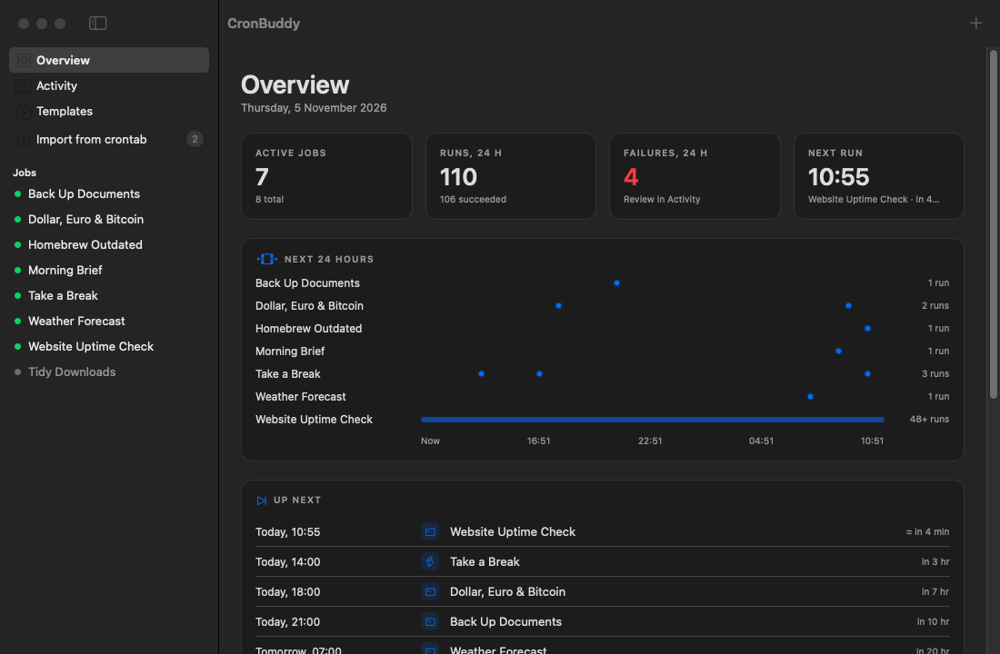

Version 2 is a rewrite in Swift and SwiftUI that replaces the original Python app. The design and engineering decisions behind it are in [docs/architecture.md](docs/architecture.md).

### Contents

1. [Install](#1-install)
2. [The menu bar](#2-the-menu-bar)
3. [Create a job](#3-create-a-job)
4. [Test it, then watch it run](#4-test-it-then-watch-it-run)
5. [History and logs](#5-history-and-logs)
6. [Templates](#6-templates)
7. [Bring over your crontab](#7-bring-over-your-crontab)
8. [Settings and themes](#8-settings-and-themes)
9. [Permissions: one grant covers every job](#9-permissions-one-grant-covers-every-job)
10. [Where things live](#10-where-things-live)
11. [Upgrading from 1.x](#11-upgrading-from-1x)

### 1. Install

Requires macOS 14 or later and Xcode (or the Swift 6 toolchain).

```bash
git clone https://github.com/lucasrafaldini/cronbuddy.git
cd cronbuddy
make install
```

`make install` builds `CronBuddy.app` and copies it to `/Applications`. Use `make app` to only build it into `build/`, `make dmg` for a disk image, and `make test` to run the test suite.

On first launch CronBuddy opens its window once, then lives in the menu bar. Opening the app again from Finder or Spotlight brings the window back.

### 2. The menu bar

Click the clock to see what runs next and how every job did last time. Hover a job to run it now or pause it; click it to open its details. The menu bar can also show a countdown to the next run, and the icon changes when a job is running or its last run failed.

| System | Thoth theme |
| --- | --- |
| 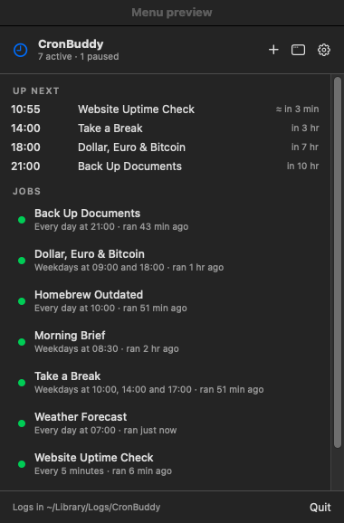 | 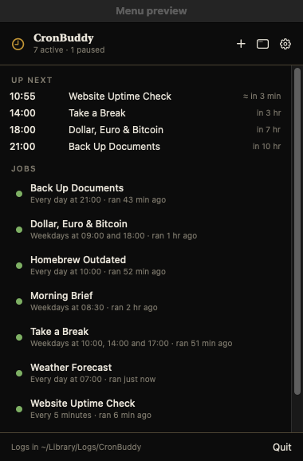 |

### 3. Create a job

Press **+** (or ⌘N). A job is a name, an action and a schedule:

- **Action:** a shell command, a script file (shell, Python, Ruby, AppleScript, JavaScript for Automation or an Automator `.workflow`), inline AppleScript, or one of your Shortcuts.
- **Schedule:** every N minutes or hours, hourly, daily at one or more times, on chosen weekdays, on chosen days of the month, at login, or a raw cron expression. The next runs are previewed as you edit.
- **Runs with:** launchd (recommended: it catches up on runs missed while the Mac slept) or cron.
- **Environment** variables, and whether to notify on failure or success.

| A command from a template | An AppleScript |
| --- | --- |
| 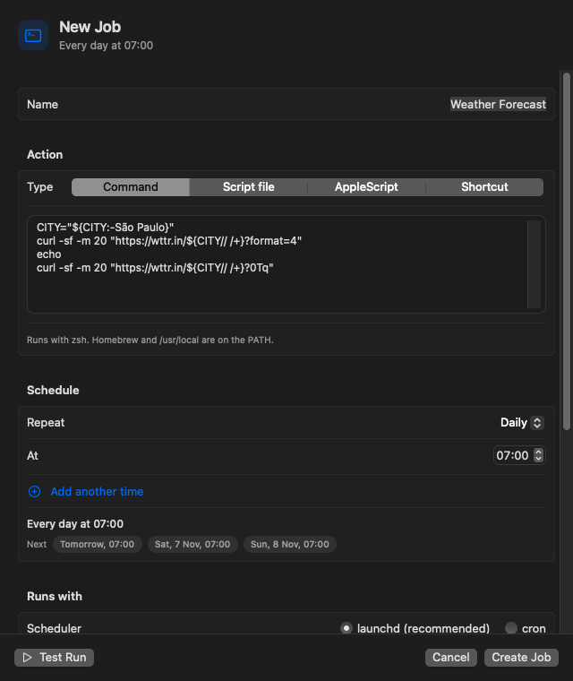 | 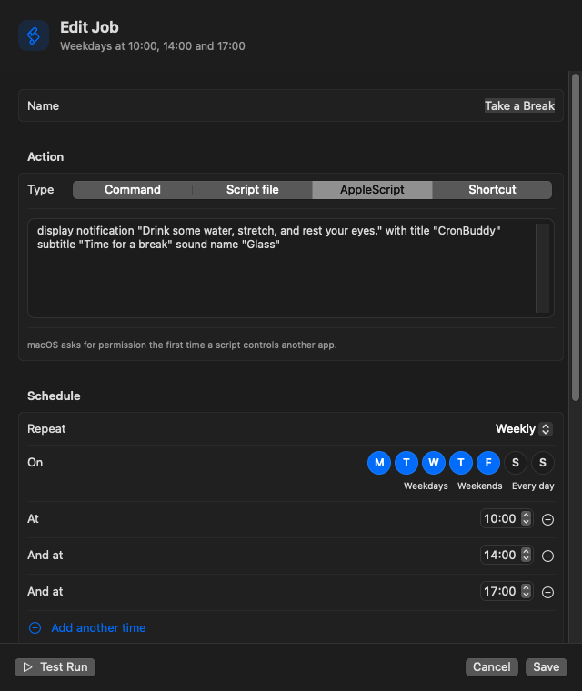 |

The **Create Job** button stays disabled until the job is valid, and the editor explains what's missing, for example an interval that cron can't express.

### 4. Test it, then watch it run

**Test Run** in the editor runs the action exactly as written, before saving, and streams its output. On a saved job, **Run Now** (⌘R) does the same and records the run in its history.

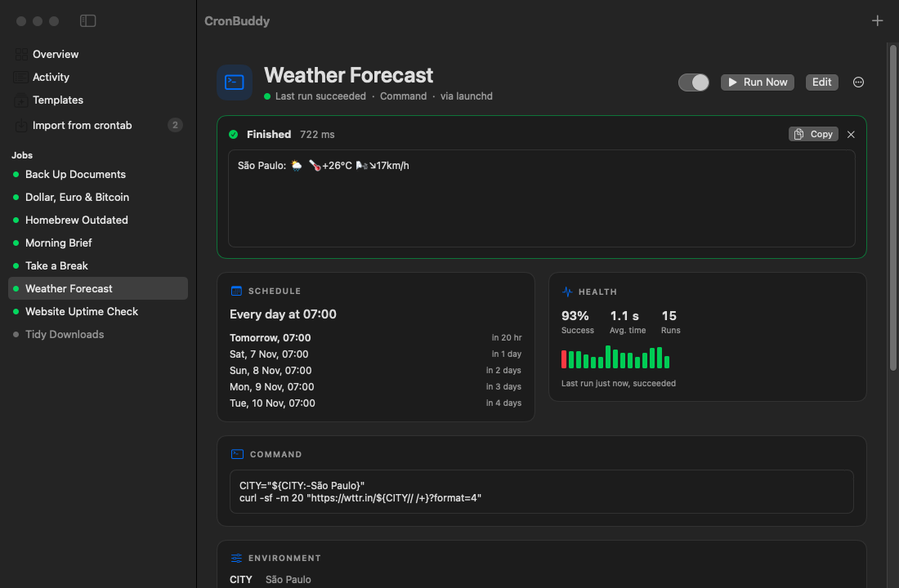

### 5. History and logs

Every run, scheduled or manual, is recorded with its full output, exit code and duration. A job's page shows its next runs, success rate, a strip of recent run times, and its history with a searchable log viewer.

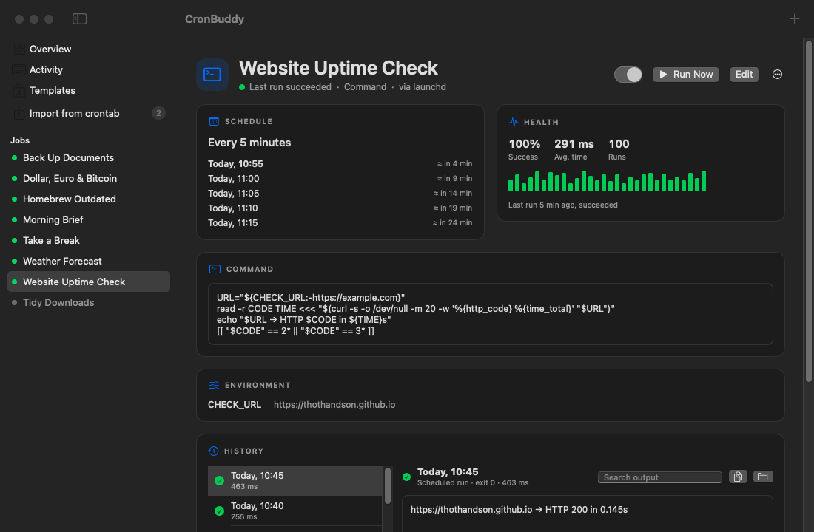

**Activity** lists every run of every job, newest first, and can filter to failures.

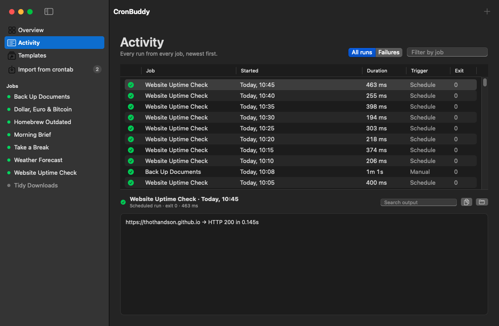

### 6. Templates

Twenty ready-made jobs, from disk reports and backups to uptime checks, Homebrew updates, exchange rates, break reminders and Dark Mode in the evening. Each opens in the editor first, so you can adjust it before saving.

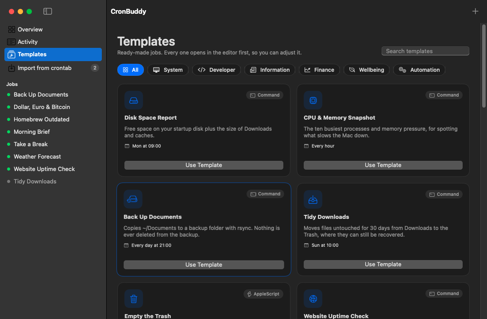

### 7. Bring over your crontab

**Import from crontab** lists entries already in your crontab that CronBuddy doesn't manage. Importing one replaces the line with a managed equivalent, on the same schedule, now with logs and history. CronBuddy never changes crontab lines it doesn't own.

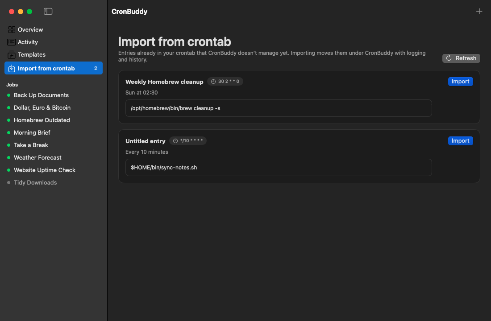

### 8. Settings and themes

Settings (⌘,) has *open at login*, the menu bar countdown, how many runs to keep per job, the folders CronBuddy uses, and a *Reinstall every job* button for moving to a new Mac.

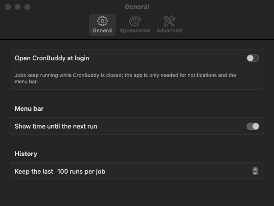

Five themes: System, Thoth (black and gold, in serif), Paper, Nord and Phosphor.

| Thoth | Paper |
| --- | --- |
| 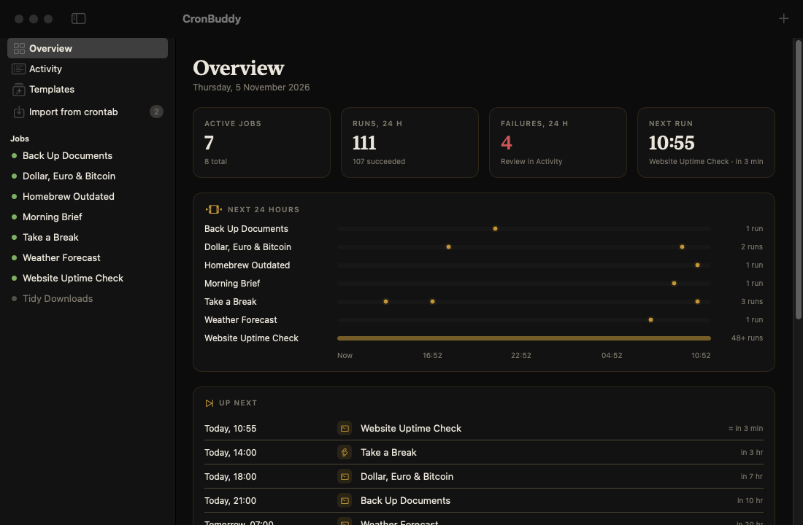 | 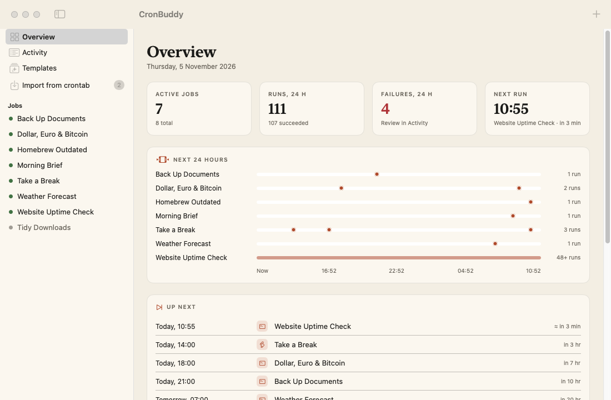 |
| **Nord** | **Phosphor** |
| 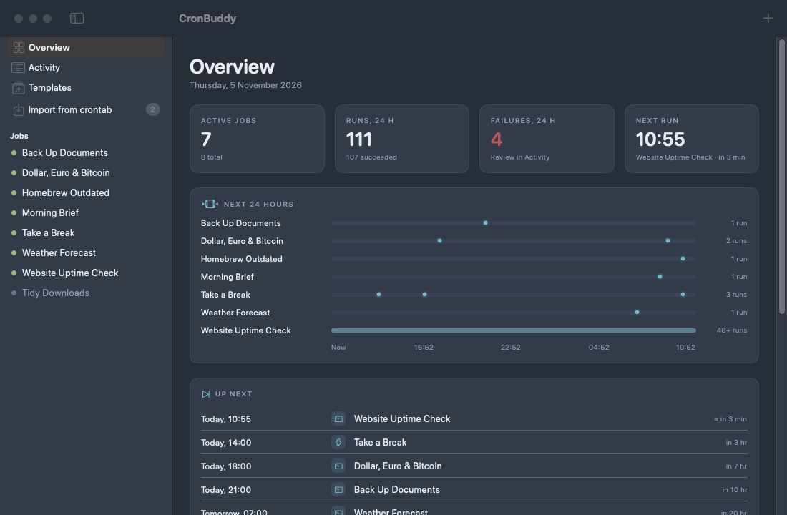 | 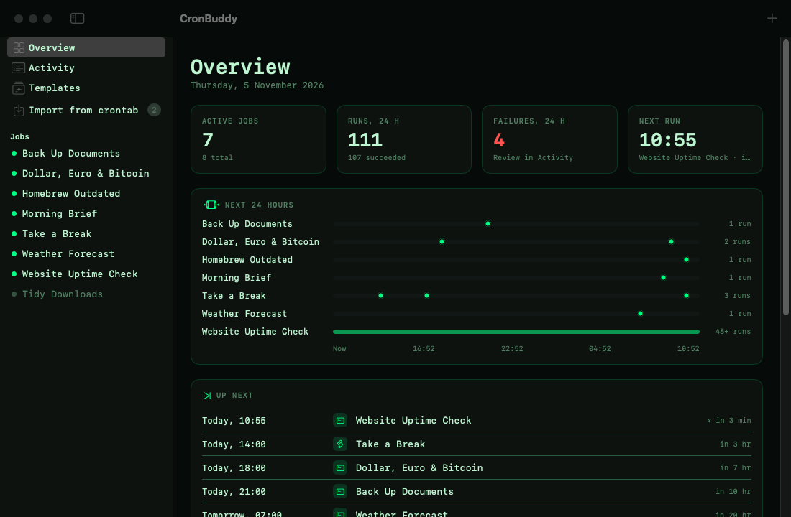 |

### 9. Permissions: one grant covers every job

macOS gives cron and launchd jobs no privacy permissions, so a job that touches iCloud Drive, Documents, external disks or other protected folders fails with `Operation not permitted`.

CronBuddy runs every job through its own executable. launchd jobs start `CronBuddy.app` directly; cron jobs keep cron's timing, and their crontab line asks launchd to start the same executable. macOS then holds CronBuddy responsible for every job, so a single grant covers all of them:

1. Open **System Settings → Privacy & Security → Full Disk Access** and add `CronBuddy.app`.
2. That's it. Every job, current and future, inherits the permission.

An ad-hoc signed build gets a new signature every time it's rebuilt, which resets the grant. To keep it across updates, sign with a stable identity:

```bash
CODESIGN_IDENTITY="Developer ID Application: Your Name (TEAMID)" make install
```

### 10. Where things live

| What | Where |
| --- | --- |
| Job definitions | `~/Library/Application Support/CronBuddy/jobs.json` |
| Generated action scripts | `~/Library/Application Support/CronBuddy/actions/` |
| Run logs and history | `~/Library/Logs/CronBuddy/<job id>/` |
| Launch agents (every job) | `~/Library/LaunchAgents/com.lucasrafaldini.cronbuddy.job.*.plist` |
| cron entries | lines in your crontab ending in `# cronbuddy:<job id>` |

### 11. Upgrading from 1.x

Crontab lines written by 1.x (`open -a CronBuddy.app --args --run '<command>' --name '<job>'`) keep working: version 2 understands that format and logs those runs to `~/CronBuddyScripts/logs` as before. They also appear under **Import from crontab**, labelled *CronBuddy 1.x*. Importing them is recommended: while a 1.x line is running, macOS treats it as the open app, so clicking CronBuddy won't show its window until the run ends.

---

<a id="português"></a>
## Português

**CronBuddy** é um app nativo de barra de menus do macOS para agendar tarefas no Mac: comandos de shell, scripts, AppleScripts, fluxos do Automator e Atalhos. Mostra o que roda a seguir, guarda a saída completa de cada execução e avisa quando algo falha.

A versão 2 foi reescrita em Swift e SwiftUI e substitui o app original em Python.

### Recursos

- **Barra de menus em primeiro lugar:** próximas execuções, último resultado de cada job e botões para rodar ou pausar sem abrir janela. Contagem regressiva opcional até a próxima execução.
- **Quatro tipos de ação:** comando de shell, arquivo de script (shell, Python, Ruby, AppleScript `.scpt`, JavaScript para Automação, `.workflow` do Automator), AppleScript inline ou qualquer atalho do app Atalhos.
- **Agendamento em linguagem natural:** a cada N minutos ou horas, de hora em hora, diário em vários horários, dias da semana, dias do mês, no login ou expressão cron. O editor mostra as próximas execuções enquanto você edita.
- **launchd ou cron:** launchd é o padrão (nativo do macOS, recupera execuções perdidas enquanto o Mac dormia); cron continua disponível.
- **Teste antes de salvar:** o *Test Run* do editor executa a ação exatamente como escrita e mostra a saída ao vivo.
- **Histórico e logs:** toda execução, agendada ou manual, fica registrada com saída, código de saída e duração. Busca dentro dos logs, taxa de sucesso por job e a tela *Activity* com tudo.
- **Notificações** quando uma execução falha (ou, opcionalmente, quando dá certo, com prévia da saída).
- **Templates:** vinte jobs prontos, incluindo cotação do dólar, SELIC/CDI/IPCA, clima, backups, checagem de site no ar e lembretes de pausa.
- **Importar do crontab:** entradas existentes viram jobs gerenciados com um clique.
- **Temas:** Sistema, Thoth (preto e dourado), Paper, Phosphor e Nord.

### Instalação

Requer macOS 14 ou superior e Xcode (ou o toolchain Swift 6).

```bash
git clone https://github.com/lucasrafaldini/cronbuddy.git
cd cronbuddy
make install
```

### Permissões: uma autorização vale para todos os jobs

O macOS não dá permissões de privacidade a jobs do cron e do launchd, então jobs que mexem no iCloud Drive, em Documentos ou em discos externos falham com `Operation not permitted`. O CronBuddy executa cada job pelo próprio executável, então basta adicionar o `CronBuddy.app` em **Ajustes do Sistema → Privacidade e Segurança → Acesso Total ao Disco**. Builds com assinatura ad-hoc ganham uma assinatura nova a cada recompilação; para manter a permissão entre atualizações, assine com uma identidade fixa (`CODESIGN_IDENTITY=… make install`).

### Vindo do CronBuddy 1.x

Linhas do crontab criadas pela 1.x (`--run '<comando>' --name '<job>'`) continuam funcionando e registrando em `~/CronBuddyScripts/logs`. Elas também aparecem em **Import from crontab** com o selo *CronBuddy 1.x*, para migrar quando quiser.

---

<a id="español"></a>
## Español

**CronBuddy** es una app nativa de barra de menús de macOS para programar tareas en tu Mac: comandos de shell, scripts, AppleScripts, flujos de Automator y Atajos. Muestra lo que se ejecuta a continuación, guarda la salida completa de cada ejecución y avisa cuando algo falla.

La versión 2 está reescrita en Swift y SwiftUI y reemplaza la app original en Python.

### Funciones

- **Barra de menús primero:** próximas ejecuciones, último resultado de cada job y botones para ejecutar o pausar sin abrir ventanas.
- **Cuatro tipos de acción:** comando de shell, archivo de script, AppleScript o cualquier atajo de la app Atajos.
- **Programación en lenguaje natural:** cada N minutos u horas, diaria en varios horarios, días de la semana o del mes, al iniciar sesión o expresión cron, con vista previa de las próximas ejecuciones.
- **launchd o cron**, prueba en vivo antes de guardar, historial con salida y código de salida, notificaciones de fallos, veinte plantillas, importación desde crontab y cinco temas.

### Instalación

Requiere macOS 14 o posterior y Xcode (o el toolchain de Swift 6).

```bash
git clone https://github.com/lucasrafaldini/cronbuddy.git
cd cronbuddy
make install
```

### Permisos

CronBuddy ejecuta cada job a través de su propio ejecutable, así que basta con añadir `CronBuddy.app` en **Ajustes del Sistema → Privacidad y Seguridad → Acceso Total al Disco** para que todos los jobs puedan acceder a carpetas protegidas. Las líneas de crontab de la versión 1.x siguen funcionando y pueden importarse desde **Import from crontab**.

---

MIT License.
